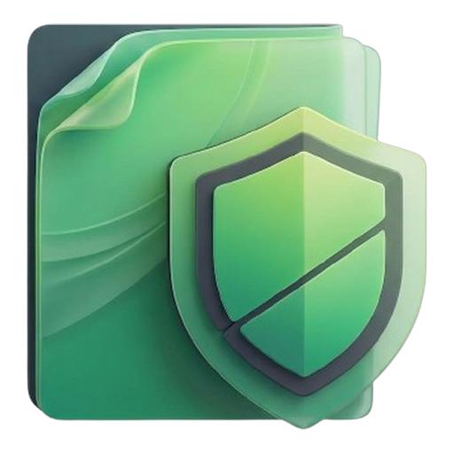

<div align="center">
  
  <h1>SupraPDF Studio</h1>
  <p><strong>Official Public Releases & Binary Distribution</strong></p>

  <p>
    <a href="https://github.com/juacortesva/suprapdf-studio-releases/releases/tag/v1.1.0"></a>
    <a href="LICENSE"></a>
    <a href="https://github.com/juacortesva/suprapdf-studio-releases/releases"></a>
    <a href="https://github.com/juacortesva/suprapdf-studio-releases"></a>
  </p>
</div>

---

Repositorio oficial y portal público de distribución de binarios certificados de **SupraPDF Studio**, la suite integral de productividad documental para Windows diseñada para la soberanía absoluta de datos y ejecución local desacoplada.

---

## 📥 Descargas Oficiales — Versión 1.1.0 "Onyx" (2026)

| Formato de Distribución | Tamaño | Arquitectura | Enlace de Descarga Directa |
| :--- | :--- | :--- | :--- |
| **Instalador Oficial (Setup)** | 111.68 MB | Windows x64 | [⬇ Descargar Setup (`.exe`)](https://github.com/juacortesva/suprapdf-studio-releases/releases/download/v1.1.0/SupraPDF_Studio_Setup_v1.1.0_Onyx.exe) |
| **Paquete Portable (.zip)** | 161.80 MB | Windows x64 | [⬇ Descargar Portable (`.zip`)](https://github.com/juacortesva/suprapdf-studio-releases/releases/download/v1.1.0/SupraPDF_Studio_v1.1.0_Onyx_Portable.zip) |

---

## 🔒 Sumas de Verificación e Integridad (SHA-256 Checksums)

Para verificar la integridad criptográfica y autenticidad de los archivos descargados, compare el hash generado localmente mediante PowerShell (`Get-FileHash -Algorithm SHA256 <archivo>`) con los valores oficiales certificados:

| Archivo de Release | Tamaño | Hash SHA-256 Verificado |
| :--- | :--- | :--- |
| `SupraPDF_Studio_Setup_v1.1.0_Onyx.exe` | 111.68 MB | `7DC78C12A573118BBC274CD2BB3607D59C9F2AF97246276529FEF26B202697FE` |
| `SupraPDF_Studio_v1.1.0_Onyx_Portable.zip` | 161.80 MB | `D80903D7147C13BC2BF86CA1FC743342B9302980EB91A62BDD22F3008C3902EC` |

### Verificación rápida en PowerShell:
```powershell
# Para el instalador Setup:
(Get-FileHash .\SupraPDF_Studio_Setup_v1.1.0_Onyx.exe -Algorithm SHA256).Hash -eq "7DC78C12A573118BBC274CD2BB3607D59C9F2AF97246276529FEF26B202697FE"

# Para la versión Portable:
(Get-FileHash .\SupraPDF_Studio_v1.1.0_Onyx_Portable.zip -Algorithm SHA256).Hash -eq "D80903D7147C13BC2BF86CA1FC743342B9302980EB91A62BDD22F3008C3902EC"
```

---

## 🚀 Novedades de la Versión 1.1.0 "Onyx"

- **Visor PDF Nativo Vectorial:** Motor de alta precisión con modos de página, miniaturas y buscador de texto integrado sin dependencias pesadas.
- **Extracción Nativa Lossless de Imágenes:** Extracción fidedigna de XObjects binarios directamente a carpeta o empaquetado automático en ZIP con barra de progreso asíncrona.
- **Módulo Dedicado de Reparación de PDF:** Reconstrucción física de tablas de referencias cruzadas (`xref`) corruptas, flujos binarios y árboles de páginas rotos.
- **Soporte Multilingüe Reactivo en 6 Idiomas:** Paridad estricta al 100% y cambio en caliente entre Español, Inglés, Francés, Portugués, Ruso y Chino Simplificado.
- **Herramientas Recientes Dinámicas:** Panel de inicio renovado con rastreador FIFO de las últimas 5 herramientas utilizadas.
- **Pestaña de Metadatos Documentales:** Inspección y purga forense de información confidencial y propiedades de autoría.
- **Comparador Visual de Documentos:** Detección lado a lado de discrepancias visuales y estructurales entre PDFs.
- **Editor Visual Enriquecido:** Sellos, formas geométricas vectoriales y firmas manuscritas con remoción inteligente de fondo blanco.
- **Rediseño Estético Onyx:** Paleta sobria grafito/obsidiana con ventana *frameless*, barra de título integrada y acentos esmeralda.

---

## 🛡️ Compromiso de Privacidad Absoluta (100% Offline / Air-Gapped)

- **Cero Telemetría y Cero Nube:** SupraPDF Studio no transmite datos, métricas ni telemetría a servidores remotos.
- **Procesamiento Exclusivo en CPU/RAM Local:** Todas las operaciones (NLU, compresión, extracción, criptografía y renderizado) se procesan estrictamente en la memoria del dispositivo.
- **Aislamiento Seguro:** Totalmente apto para operar en redes cerradas, entornos corporativos restringidos y estaciones de trabajo desconectadas (*Air-Gapped*).

---

## 📄 Licencia

Este software se distribuye bajo la licencia [MIT](LICENSE) (o consulte en [Open Source Initiative](https://opensource.org/licenses/MIT)). Copyright © 2026 Juan David Cortés Vaca.
